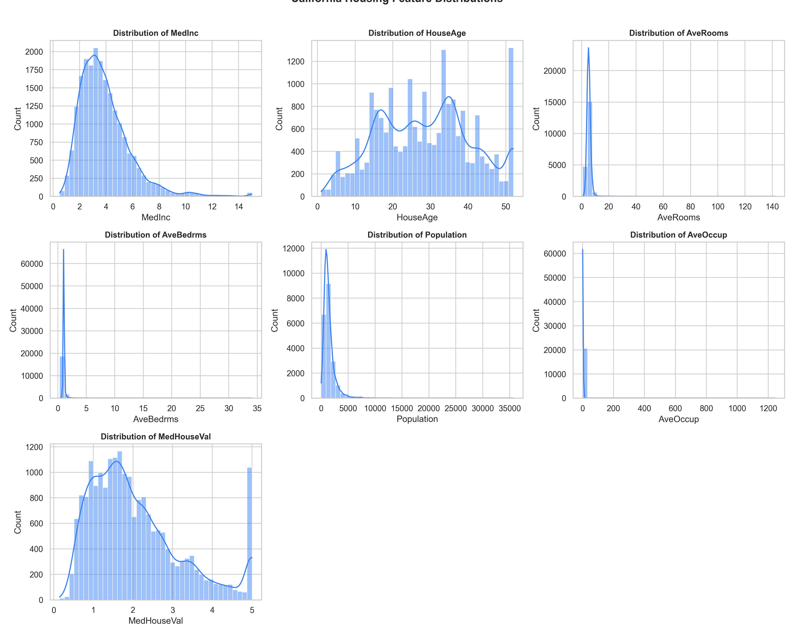
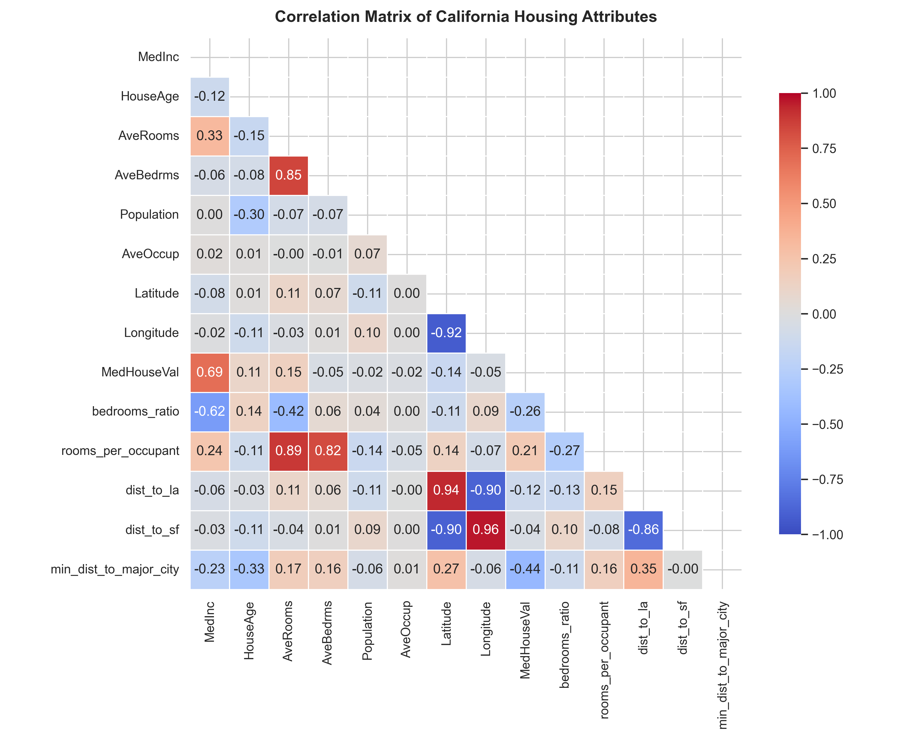
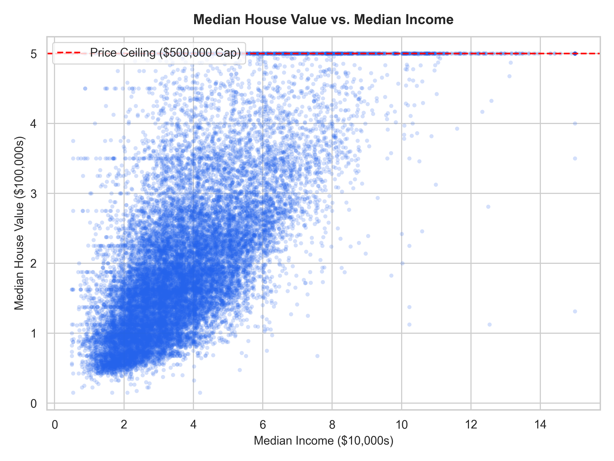
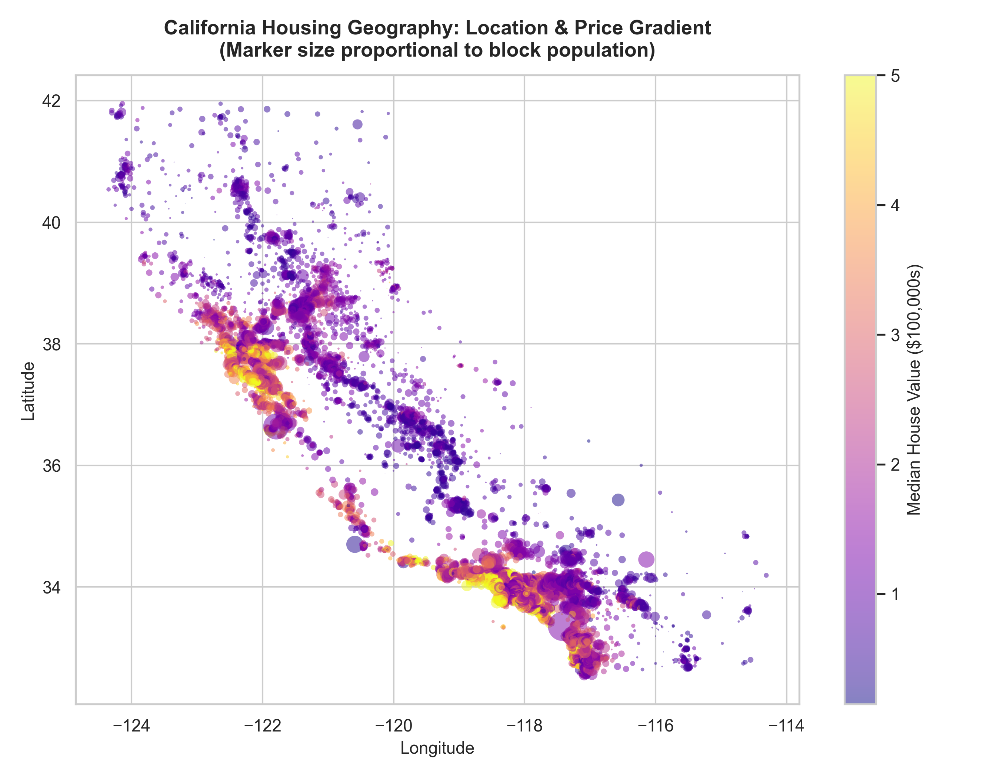
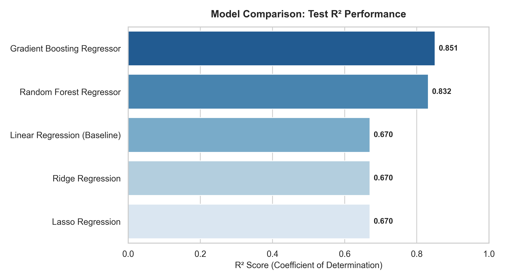
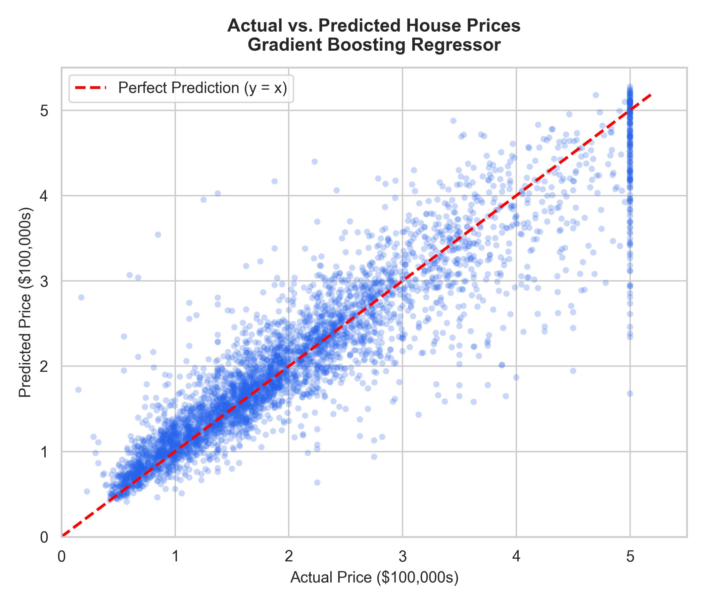
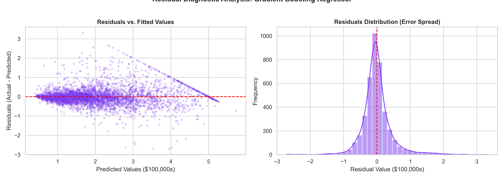

# California House Price Prediction

[](https://www.python.org/)
[](https://scikit-learn.org/)

A regression pipeline that predicts median house values for California census block groups using demographic, geographic, and structural features. Includes exploratory data analysis, domain feature engineering, cross-validation, and ensemble regression models.

---

## 1. Dataset Selection

### Note on California vs. Boston Housing
Earlier machine learning coursework frequently used the Boston Housing dataset. However, starting in `scikit-learn` version 1.2, Boston was officially deprecated and removed due to severe ethical and racial bias concerns (specifically the `B` variable).

Following standard best practices, this project uses the **California Housing dataset** derived from the 1990 U.S. Census:
- **Records:** 20,640 census block groups
- **Attributes:** 8 baseline features + domain-engineered features
- **Target:** `MedHouseVal` (Median house value in units of $100,000)

---

## 2. Exploratory Data Analysis (EDA)




### Key Observations

1. **Median Income:** Median income (`MedInc`) is the strongest single linear predictor ($r \approx 0.69$) of home values.


2. **$500,000 Price Ceiling:** The original survey data capped median values at `$5.0` ($500,000). Blocks above this valuation appear as a sharp horizontal line in scatter plots.

3. **Geographic Distribution:** Plotting latitude and longitude shows that property values peak in coastal regions around the San Francisco Bay Area and Greater Los Angeles, while inland valley areas show noticeably lower valuations.


---

## 3. Data Cleaning & Feature Engineering

### Preprocessing
- Missing values: None in the raw dataset.
- Extreme values: Very high values from small census tracts (e.g. `AveRooms > 20`, `AveOccup > 20`) were clipped to prevent coefficient distortion in linear and gradient-based models.

### Feature Engineering (`src/features.py`)
A custom Scikit-Learn transformer (`HousingFeatureEngineering`) creates:
1. `bedrooms_ratio`: `AveBedrms / AveRooms` — Ratio of bedrooms to total rooms.
2. `rooms_per_occupant`: `AveRooms / AveOccup` — Living space per resident.
3. `dist_to_la` & `dist_to_sf`: Euclidean distance approximations to Los Angeles and San Francisco city centers.
4. `min_dist_to_major_city`: Distance to the closest major metropolitan center.

All transformations and `StandardScaler` scalings are wrapped inside Scikit-Learn pipelines and fitted **strictly on the training split** to prevent data leakage.

---

## 4. Models & 5-Fold Cross-Validation

We evaluated 5 models on an **80/20 train/test split** (`random_state=42`) with **5-Fold Cross-Validation**:
- Linear Regression (Baseline)
- Ridge Regression
- Lasso Regression
- Random Forest Regressor
- Gradient Boosting Regressor

---

## 5. Benchmark Results

| Model | Test RMSE ($100k) | Test RMSE (USD) | Test MAE ($100k) | Test MAE (USD) | Test R² Score |
| :--- | :---: | :---: | :---: | :---: | :---: |
| **Gradient Boosting Regressor** | **0.4425** | **$44,250.60** | **0.2859** | **$28,585.80** | **0.8506** |
| Random Forest Regressor | 0.4692 | $46,916.69 | 0.2990 | $29,896.40 | 0.8320 |
| Linear Regression (Baseline) | 0.6575 | $65,753.96 | 0.4739 | $47,393.40 | 0.6701 |
| Ridge Regression | 0.6575 | $65,754.05 | 0.4739 | $47,392.70 | 0.6701 |
| Lasso Regression | 0.6577 | $65,765.47 | 0.4739 | $47,385.60 | 0.6699 |



- Gradient Boosting achieved the strongest performance with an $R^2$ of **0.8506**, reducing root mean squared error from ~$65.7k (baseline) to ~$44.2k.

---

## 6. Model Diagnostics & Feature Importance





### Diagnostics
- Residuals are centered near zero with symmetric spread.
- The $500,000 survey cap creates an under-prediction boundary for block groups at the upper ceiling.

### Top Predictors
1. `MedInc` (Median Income) — Accounts for over 50% of tree split importance.
2. `min_dist_to_major_city`, `Latitude`, `Longitude` — Distance to urban job centers and coast.
3. `bedrooms_ratio` and `rooms_per_occupant` — Structural density indicators.

---

## 7. Model Limitations

1. **Temporal Relevance:** Based on 1990 census records. Nominal figures do not reflect current housing market prices without inflation adjustments.
2. **Capped Target:** The $500,000 threshold truncates high-end luxury property values.
3. **Aggregate Unit:** Observations represent block group averages rather than individual home transactions.

---

## 8. How to Run

### CLI Prediction
```bash
python house-price-prediction/predict.py --MedInc 4.5 --HouseAge 25 --AveRooms 5.5 --AveBedrms 1.1 --Population 1200 --AveOccup 2.8 --Latitude 37.88 --Longitude -122.23
```

Interactive mode:
```bash
python house-price-prediction/predict.py
```

### Run Training Pipeline
```bash
python house-price-prediction/src/train.py
```
