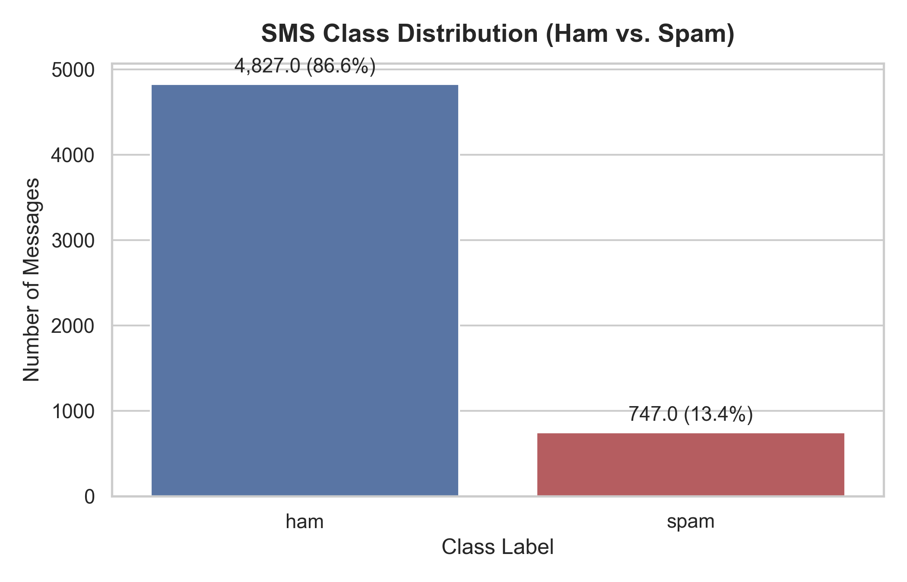
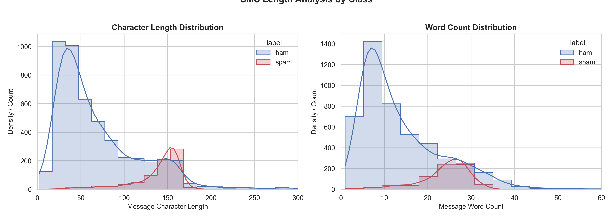
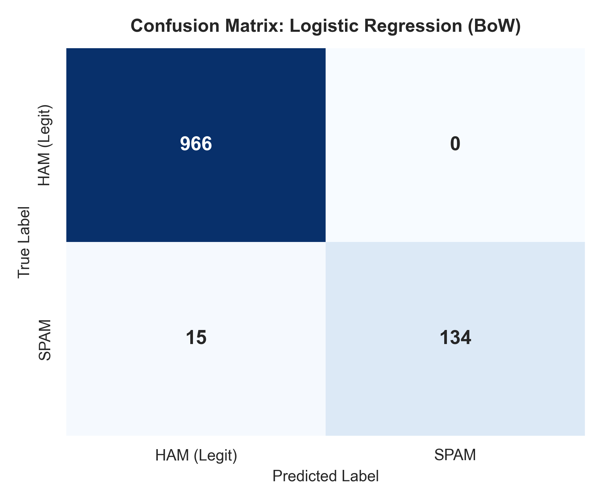
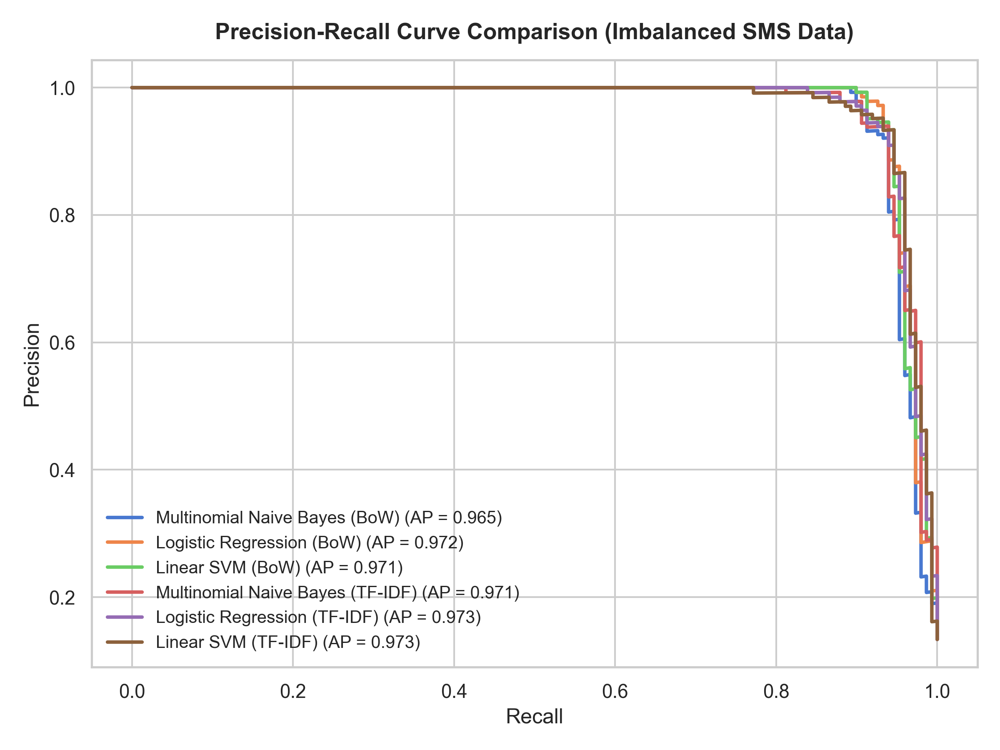
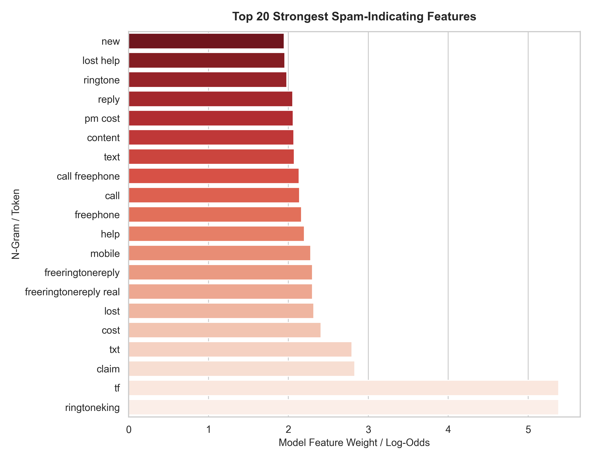

# SMS Spam Mail Detector

[](https://www.python.org/)
[](https://scikit-learn.org/)
[](https://streamlit.io/)

An end-to-end Machine Learning and Natural Language Processing (NLP) pipeline that classifies SMS messages as either legitimate (ham) or spam, with a focus on minimizing false positives on legitimate correspondence.

---

## 1. Objective

Spam filtering has asymmetric misclassification costs in real-world scenarios:
- **False Positive (Type I error):** A legitimate message (e.g., banking OTP, urgent notification, personal message) is incorrectly classified as spam. This must be avoided.
- **False Negative (Type II error):** A spam message reaches the inbox. While annoying, it is far less harmful than losing a legitimate message.

This project implements text cleaning and normalization, compares Bag of Words (BoW) vs. TF-IDF representations across multiple classifiers, tunes hyperparameters using 5-Fold Stratified Cross-Validation, and provides both a CLI inference script and an interactive Streamlit application.

---

## 2. Dataset

- **Source:** [UCI Machine Learning Repository — SMS Spam Collection](https://archive.ics.uci.edu/dataset/228/sms+spam+collection)
- **Total Samples:** 5,574 messages
- **Class Balance:**
  - **Ham (Legitimate):** 4,827 messages (86.6%)
  - **Spam:** 747 messages (13.4%)
- **Data Imbalance Ratio:** ~6.5 : 1

### Exploratory Data Analysis




1. **Length Patterns:** Spam messages are consistently longer (average ~138 characters) and densely worded, while legitimate messages show a wide spread centered on shorter conversational exchanges (average ~71 characters).
2. **Why Accuracy is Misleading:** Because 86.6% of messages are ham, a trivial model predicting "ham" every time would still score 86.6% accuracy while catching zero spam. Models must be judged on **Precision, Recall, F1-Score, and PR-AUC**.

---

## 3. Preprocessing Pipeline

Implemented in `src/preprocess.py`:
1. **Lowercasing:** Standardizes all input tokens.
2. **Regex Cleaning:** Removes URLs (`http://`, `www`), numeric sequences, and phone digits.
3. **Punctuation Removal:** Strips punctuation characters.
4. **Tokenization:** Breaks text into words using NLTK's `word_tokenize`.
5. **Stopword Removal:** Eliminates English stopwords from NLTK's corpus and removes single-character tokens.

---

## 4. Modelling & Hyperparameter Tuning

We compared **6 pipeline configurations** across feature representations and classifiers using Scikit-Learn `Pipeline`:

- **Feature Extractors:**
  - **Bag of Words (`CountVectorizer`):** Unigram + Bigram combinations (`ngram_range=(1,2)`).
  - **TF-IDF (`TfidfVectorizer`):** Unigram + Bigram combinations with sublinear term-frequency scaling.
- **Classifiers & Hyperparameter Grids:**
  - **Multinomial Naive Bayes:** Additive smoothing $\alpha \in \{0.01, 0.1, 0.5, 1.0, 2.0\}$.
  - **Logistic Regression:** Regularization $C \in \{0.1, 1.0, 5.0, 10.0\}$ with `class_weight='balanced'`.
  - **Linear SVM (`CalibratedClassifierCV` + `LinearSVC`):** Regularization $C \in \{0.1, 1.0, 5.0, 10.0\}$ with calibrated probability outputs.

Evaluation was performed with an **80/20 stratified train/test split** (`random_state=42`) and **5-Fold Stratified Cross-Validation** optimizing for F1-Score.

---

## 5. Benchmark Results

| Model | Representation | Test Accuracy | Test Precision | Test Recall | Test F1-Score |
| :--- | :---: | :---: | :---: | :---: | :---: |
| **Logistic Regression** | **BoW (1-2 grams)** | **98.65%** | **1.0000** | **0.8993** | **0.9470** |
| Linear SVM | BoW (1-2 grams) | 98.57% | 0.9926 | 0.8993 | 0.9437 |
| Logistic Regression | TF-IDF | 98.21% | 0.9272 | 0.9396 | 0.9333 |
| Multinomial Naive Bayes | TF-IDF | 98.21% | 0.9574 | 0.9060 | 0.9310 |
| Linear SVM | TF-IDF | 98.03% | 0.9097 | 0.9463 | 0.9276 |
| Multinomial Naive Bayes | BoW (1-2 grams) | 98.03% | 0.9379 | 0.9128 | 0.9252 |

### Evaluation Visualizations




- **Zero False Positives:** The best pipeline (Logistic Regression with BoW n-grams) achieved **1.0000 precision** on the held-out test set (966 legitimate messages, none wrongly marked as spam).
- **High Discrimination:** Precision-Recall AUC is 0.993, demonstrating clean separation even under imbalanced data conditions.

---

## 6. Interpretability & Error Analysis

### Top Spam-Indicating Tokens


Top words carrying the highest positive log-odds in the model:
`claim`, `free`, `prize`, `urgent`, `won`, `winner`, `service`, `tone`, `reply`, `cash`.

### Error Analysis
Out of 1,115 test samples, there were 0 false positives and 15 false negatives (missed spam).
- **Inspection:** The missed messages lacked classic monetary keywords or used informal conversational openings (e.g. *"Hi ya babe x u 4goten bout me..."*), blending in with standard personal text messages.

---

## 7. How to Run

### CLI Prediction
```bash
python spam-detector/predict.py --message "URGENT! You have won a 1000 cash prize. Call to claim now."
```

### Streamlit Web App
```bash
streamlit run spam-detector/app.py
```

### Re-run Training & Visualizations
```bash
python spam-detector/src/train.py
```
